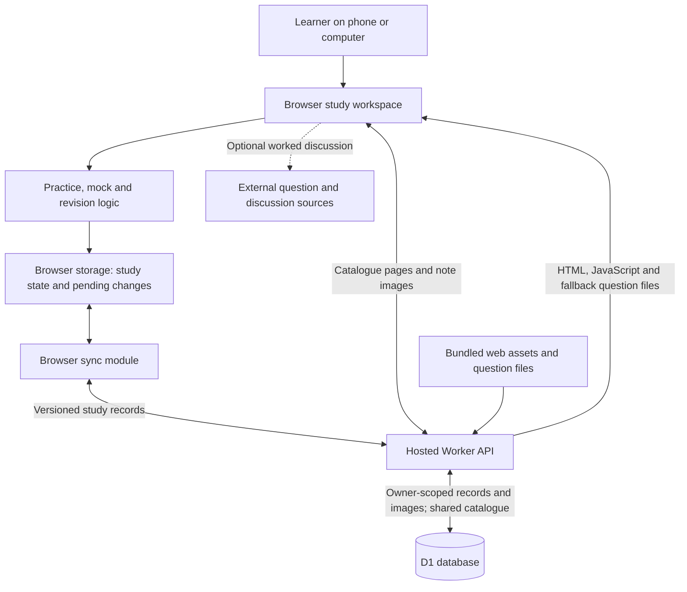
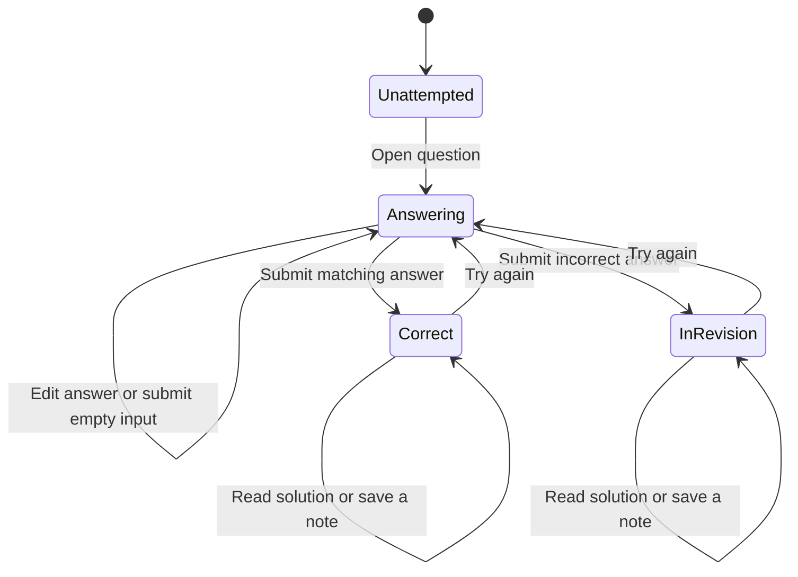
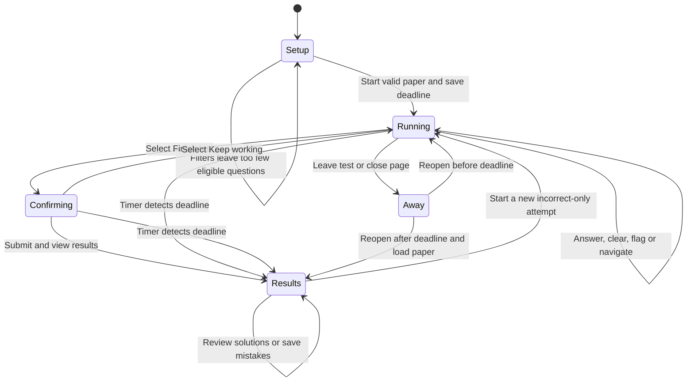
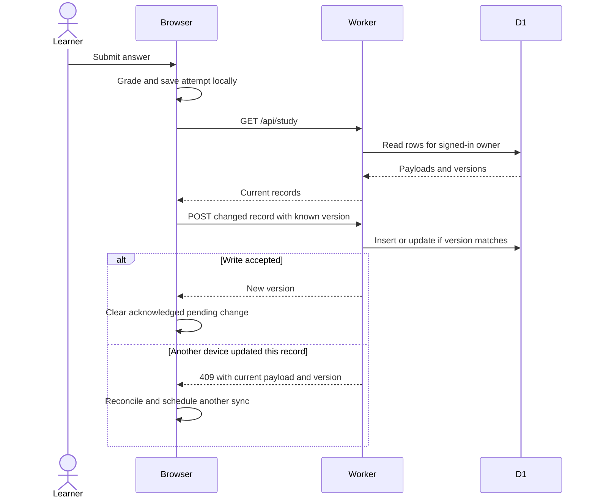

# GATE Study Desk | System and architecture guide

**Implementation reviewed on 27 November 2026** · [Open the site](https://gate-cs-study-desk.gallantmyrrh5.chatgpt.site) · [Source snapshot](https://github.com/sonudev2002/gatewebsite/tree/2f00969231fa6e980db476e9215689674f69c734/study-desk)

## 1. What the system does

GATE Study Desk is a personal GATE CSE practice and revision website. It connects three activities that are often kept separately: learning a concept, testing it under exam conditions, and revisiting the exact place where your reasoning went wrong.

For example, search **scheduling**. Choose the concept lesson to study how a CPU chooses its next process, or open the matching PYQ group to practise. If you get a waiting-time question wrong, the attempt enters your practice revision queue. Save a **Formula** note with “waiting time = turnaround time − burst time” for a single-CPU-burst problem. Attach your Gantt chart so you can reconstruct the calculation. A later correct attempt clears that question from the current practice queue; the earlier attempt and your saved note still serve different purposes.

| Part of the site | What you do | What the system uses or produces |
|---|---|---|
| Overview and search | Find a subject, topic or subtopic. Resume a running mock. | Links to lessons and filtered PYQs. The seven-day chart counts practice submissions, so retrying a question adds another attempt. |
| Topic Library | Read lessons, bookmark topics and record confidence or preparation status. | Groups the archive by subject and topic. Shows frequency, marks, weightage and recorded misses. |
| Practice Bank | Choose actual previous-year questions (PYQs) or ChatGPT-authored practice. Submit and review an answer. | Saves each attempt. Previous/Next moves within the current filtered PYQ sequence. Available worked explanations and quick points appear after submission. |
| Mock Tests | Build a timed paper, answer, flag, navigate and submit. | Saves the selected paper and responses, then computes score, accuracy, timing, topic breakdowns and question review. |
| Revision Dashboard | Review queued mistakes or create and edit notes. | Stores Concepts, Formulas, Key Points, Shortcuts and Mistakes. A note can reference a question and hold screenshots or saved handwriting. |
| Mistake Log | Revisit past errors and look for repeated ones. | Uses attempt history. Two wrong attempts on one topic are different from two distinct questions still needing revision. |
| Question Studio | Write your own questions, solutions and working. Mark questions for another attempt. | Maintains a personal bank separately from the shared archive. |

## 2. How the parts fit together

The browser runs the study experience, including question selection, timers and grading. A hosted Worker delivers the application and handles authenticated data requests. D1 is the hosted SQL database. Browser storage lets a study session survive an ordinary page reload while synchronization is pending.

**Where the questions come from.** The reviewed release includes 2,611 archived PYQs spanning 1997–2026, 24 core ChatGPT-authored practice questions and 192 generated variants for mock selection. Generated mocks sample a prepared bank. The test builder does not call a language model each time you start a test. Archive coverage and worked-solution depth vary. Some questions rely on a source discussion for the derivation or original diagram.

**How a page opens.** The browser first loads the application shell. A route such as `#exam/<id>` tells it which view to display. For the larger archive and generated mock bank, it requests catalogue pages of 36 questions. If that route is unavailable, it loads the bundled JSON files. Topic and question IDs connect those questions to previously saved work.

## 3. Practice question state diagram

Read each arrow as **event → new state**. The revision queue is calculated from attempt history. Opening a worked solution, saving a formula and mastering a question are separate actions.

**Example.** On a multiple-select question with key A and C, selecting only A counts as incorrect. A retry with A and C produces a second attempt. The latest graded result now marks the question correct, but an analysis of historical mistakes can still count the first miss. The archive also supports an *awaiting review* path for a question without an automatic key, where the learner can compare the source and record the outcome.

## 4. Mock test state diagram

**What “resume” means.** A run stores its question IDs, individual marks, current position, answers, flags and absolute end time. Leaving the page can stop active time being assigned to the current question; the deadline continues. An expired run finishes when the loaded exam view checks its clock. The diagram’s *Away* and *Confirming* states describe the learner’s experience. The saved run uses a completion timestamp to distinguish an ongoing run from a completed one.

**How scoring works.** Let a question carry weight *w*. A correct answer earns *w*. A wrong MCQ loses *w*/3 when GATE marking is enabled. Wrong MSQs and NATs, and all skipped questions, earn zero. MSQ grading compares the full set of selected options. NAT grading checks the accepted numeric interval. Accuracy is correct answers divided by attempted answers. If all questions are skipped, the interface displays a dash for accuracy.

| Full-length preset in this release | 1-mark questions | 2-mark questions | Marks |
|---|---:|---:|---:|
| General Aptitude | 5 | 5 | 15 |
| Mathematics, including Discrete Mathematics | 3 | 5 | 13 |
| Core CS | 22 | 25 | 72 |
| **Total** | **30** | **35** | **100** |

The preset runs for 180 minutes and contains 65 questions. This table describes the generator’s allocation. Custom papers scale each question’s weight so the weights add to the requested total. For example, a correct 2-mark answer, a wrong 1-mark MCQ and one skip produce **1.67 marks** and **50% accuracy** under GATE marking.

## 5. What gets stored

The database has three physical tables. An attempt, a mock run and a revision card are different *record types* inside the same study-record table. Their relationships are expressed through IDs in JSON payloads.

| Physical table | Key | What it holds |
|---|---|---|
| `study_records` | Owner + record key | JSON payload and integer version. Record families include practice attempts, PYQ attempts, weak-topic flags, topic preferences, personal cards, custom questions and mock runs. |
| `catalog_pages` | Edition + page number | Shared JSON question pages, populated from the bundled catalogue when first requested. |
| `note_images` | Owner + image ID | Base64-encoded JPEG data. A revision card holds the IDs needed to retrieve its images. |

A **mock run** stores question IDs and answers together, so the same paper can be reopened and scored. A **practice attempt** records one submission, allowing the system to calculate current status separately from historical accuracy. A **revision card** stores the learner’s note, category, subject, topic, optional question reference and image references. Uploads and saved drawings use the image API; the separate question scratchpad is device-local.

## 6. How a saved answer reaches another device

Another device signed into the same account pulls that owner’s records on its next successful sync. The app also checks on focus, when connectivity returns, and periodically. Signed-out visitors can keep study state on the current device. Saving an image needs an authenticated, successful upload. Clearing browser storage can remove local-only or pending work.

**Concurrent edits.** Suppose a phone and laptop both edit version 3 of the same card. The first accepted write becomes version 4. The second receives a conflict response. For conflicting edits to cards, custom questions, mock runs and topic preferences, the client can preserve the differing local object under a fresh ID and retry. A second card can therefore appear after simultaneous edits. This policy operates on whole records.

| API route | Purpose |
|---|---|
| `GET /api/study` | Read the signed-in owner’s study records and versions. |
| `POST /api/study` | Create or conditionally update one record using its expected version. |
| `GET /api/catalog?page=N` | Read an authenticated catalogue page. Bundled data provides the browser fallback. |
| `PUT /api/image/<id>` | Upload a JPEG against the signed-in owner and image ID. |
| `GET /api/image/<id>` | Retrieve that owner’s stored note image. |

## 7. How to read the analytics

- **Frequency** counts available archive questions in a subject/topic group. **Weightage** divides that group’s marks by all marks in the archive. **Priority** uses the lower and upper third cutoffs of topic mark totals. Topics tied at a cutoff stay together. These values describe the loaded archive and can change when questions or tags are corrected.
- **Preparation status and confidence** express the learner’s progress. A learner can mark a low-frequency topic weak or bookmark a high-frequency topic already mastered. These choices answer a different question from historical exam weightage.
- **Elapsed time and active time** can differ. Leaving an exam running spends deadline time even when the browser is no longer attributing active study time to a question.
- **Practice queue and mock mistakes** follow different paths. A wrong practice answer feeds the current queue automatically. A completed mock offers explicit actions to save missed questions or create an incorrect-only reattempt.

## 8. Code map for maintenance

| When you want to change… | Start here |
|---|---|
| Dashboard, weekly activity, topic search or responsive layout | [desk.js](web/desk.js), [index.html](web/index.html), [style.css](web/style.css) |
| Core lessons, practice, revision or personal questions | [data.js](web/data.js), [app.js](web/app.js), [workspace.js](web/workspace.js), [studio.js](web/studio.js) |
| Archive navigation, grading, images or quick revision | [upgrade.js](web/upgrade.js) |
| Mock selection, exam lifecycle, scoring or reports | [exams.js](web/exams.js) |
| Topic frequency, priority or library filters | [priorities.js](web/priorities.js) |
| Cross-device behavior or storage rules | [sync.js](web/sync.js), [Worker API](worker/api.mjs), [database migrations](drizzle/) |
| Local development or deployment output | [dev.mjs](dev.mjs) runs a local SQLite-backed service. [build.mjs](build.mjs) packages the browser files, catalogue and API into the hosted Worker. |

**Design implication.** The learner’s browser receives the answer keys and performs grading. This supports quick feedback and practice simulation. The score is a study aid; the implementation does not establish the independently verified result that a proctored examination would require.
